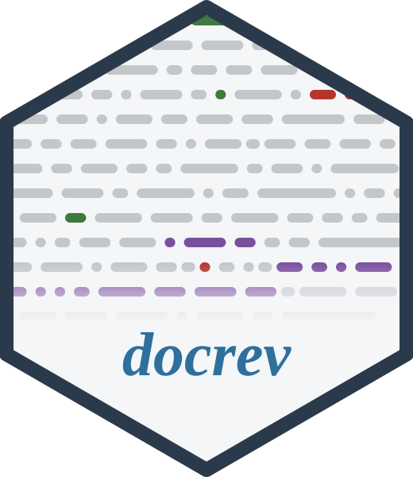
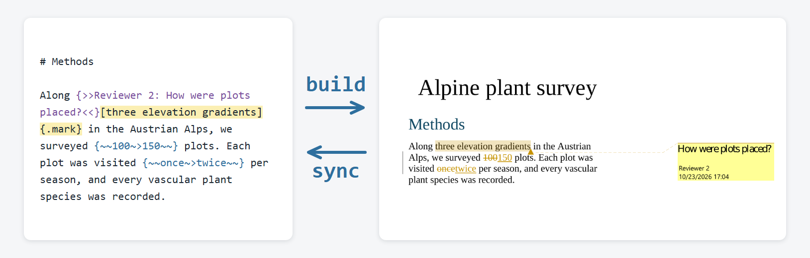

# docrev 

*writing papers in Markdown with co-authors who work in Word*

[](https://www.npmjs.com/package/docrev)
[](https://www.npmjs.com/package/docrev)
[](https://www.npmjs.com/package/docrev)
[](https://nodejs.org)
[](https://opensource.org/licenses/MIT)
[](https://github.com/gcol33/docrev/actions/workflows/ci.yml)

<p align="center"></p>

docrev lets you write a paper in plain text files while your co-authors and reviewers keep working in Microsoft Word.

You write each section of the paper (introduction, methods, results, ...) in its own [Markdown](https://commonmark.org/help/) file, a text file with light formatting marks, and keep the files under version control with git. When you want feedback, `docrev build` turns the files into a Word document or a PDF, and you send it out as usual. Your co-authors comment and edit in Word with Track Changes on.

When the file comes back, `docrev sync` copies every comment and tracked change into your text files, next to the sentence it belongs to. They are written in [CriticMarkup](https://criticmarkup.com/), a plain-text notation for edits: `{++added text++}`, `{--deleted text--}`, `{>>Reviewer 2: a comment<<}`. You read them in your editor, accept or reject each edit, reply to the comments, and build the next version. The picture above shows one such round trip.

docrev supports:

- **Round trips with Word.** Equations, figures, citations and cross-references survive the conversion to Word and the way back.
- **Answering reviewers in the terminal.** Comments and tracked changes are numbered per file, so you reply to, accept, reject or resolve each one by its number without opening Word.
- **Several reviewers.** Each build saves the DOCX it sent, and `docrev merge` compares every returned file with it, flagging passages that two reviewers changed differently.
- **PDF annotations.** A PDF with reviewer comments syncs the same way as a Word file.
- **Journal profiles.** 22 profiles hold a journal's requirements, such as word limits and figure and reference counts, for `docrev validate`; seven of them also set the citation style and PDF layout of the build.
- **References from DOIs.** `docrev doi` checks the DOIs in a BibTeX file, finds missing ones and adds an entry from a DOI.

## Installation

```bash
npm install -g docrev
```

This installs the `docrev` command and a short alias `rev`. On Linux and macOS, `rev` is usually also the name of a system tool that reverses lines, and whichever comes first on your `PATH` wins, so this README uses `docrev`.

docrev needs [Node.js](https://nodejs.org) 20.16 or later. The other tools depend on what you build:

| Tool | Needed for |
|------|------------|
| [Pandoc](https://pandoc.org) | every DOCX and PDF build |
| [pandoc-crossref](https://github.com/lierdakil/pandoc-crossref) | numbered figures, tables and equations |
| LaTeX | PDF output with math, cross-references or a journal style |

Simpler documents can build a PDF without LaTeX through a non-LaTeX pandoc engine, such as `pdf.engine: typst` in `rev.yaml`. `docrev doctor` checks that Node.js, Pandoc and pandoc-crossref are found.

### Installing Pandoc

| Platform | Command |
|----------|---------|
| macOS | `brew install pandoc pandoc-crossref` |
| Windows | `winget install JohnMacFarlane.Pandoc` |
| Debian/Ubuntu | `sudo apt install pandoc` |
| Fedora | `sudo dnf install pandoc` |

Other platforms: [pandoc.org/installing](https://pandoc.org/installing.html). On Windows and Linux, pandoc-crossref comes from its [releases page](https://github.com/lierdakil/pandoc-crossref/releases); pick the build that matches your Pandoc version.

### Installing LaTeX

| Platform | Command |
|----------|---------|
| macOS | `brew install --cask mactex` |
| Windows | `winget install MiKTeX.MiKTeX` |
| Debian/Ubuntu | `sudo apt install texlive-full` |
| Fedora | `sudo dnf install texlive-scheme-full` |

[TinyTeX](https://yihui.org/tinytex/) is a smaller distribution that downloads LaTeX packages on demand.

## Usage

A paper goes through four steps:

1. **Create the project.** `docrev new` makes a folder with one Markdown file per section and a `rev.yaml` file that holds the title, the authors and the section order.
2. **Write and build.** You write in the section files, and `docrev build docx` turns them into one Word document.
3. **Send and sync.** You send the Word document to your co-authors. When they return it with comments and tracked changes, `docrev sync` writes their feedback into your section files.
4. **Answer and rebuild.** You work through the comments and changes, then build the next version and send it.

The first two steps take three commands:

```bash
docrev new my-paper
cd my-paper
docrev build docx
```

`docrev new` asks for the section names; press Enter to use introduction, methods, results and discussion. The build writes the Word document to the `output/` folder, named after the `title` in `rev.yaml`.

To start from a paper you already have in Word, `docrev import manuscript.docx` creates the project from it: one section file per top-level heading, the images in `figures/`, and any comments and tracked changes already in the document as CriticMarkup.

## Project layout

```
my-paper/
├── rev.yaml          ← title, authors, section order, journal profile
├── introduction.md   ← one file per section
├── methods.md
├── results.md
├── discussion.md
├── references.bib    ← BibTeX bibliography
├── figures/          ← images referenced from sections
├── paper.md          ← combined source, regenerated each build
└── output/           ← built DOCX and PDF files
```

You edit the section files and `rev.yaml`, and docrev writes the rest. Each build combines the sections into `paper.md` in the order `rev.yaml` lists them. `docrev config sections "intro,methods,results,discussion"` sets your own default sections for later projects.

## Answering reviewers

```bash
docrev sync reviewed.docx
```

Tracked changes and comments arrive in the section files as [CriticMarkup](https://criticmarkup.com/), a plain-text notation for edits. You accept or reject a change by editing it:

```markdown
The sample size was {--100--}{++150++} participants.   # deletion + insertion
Data was collected {~~monthly~>weekly~~}.              # substitution
{>>Reviewer 2: Please clarify.<<}                      # comment
```

The comments can be answered without opening Word:

```bash
docrev comments                      # list all comments
docrev reply methods.md -n 1 -m "Added clarification"
docrev resolve methods.md -n 1       # mark as resolved
docrev build docx --dual             # clean + annotated versions
```

`docrev sync annotated.pdf` does the same for the comments in a PDF. Set your name for replies once with `docrev config user "Your Name"`.

## Merging several reviewers

```bash
docrev merge reviewer_A.docx reviewer_B.docx
```

Each build saves the DOCX it produced to `.rev/base.docx`. `docrev merge` compares each reviewer's file with that copy to isolate their changes, and asks you to resolve passages that two reviewers changed differently.

## Citations, figures and equations

```markdown
Climate change poses significant challenges [@IPCC2021]. As shown in
@fig:temperature, global temperatures have risen steadily.

{#fig:temperature}

The relationship follows $\Delta T = \lambda \cdot \Delta F$ (@eq:forcing).
```

Citations use keys from `references.bib`, figures and tables take a label, and equations are LaTeX. The build numbers every `@fig:`, `@tbl:` and `@eq:` reference. Mark unfinished spots with `\tofill{N sites}`, which prints as a highlighted placeholder in every output format. The [Revision Workflow](docs/workflow.md#writing-in-markdown) shows tables, display equations and section references.

## Journal profiles

```yaml
journal: nature
```

With a journal set in `rev.yaml` (or `-j nature` on the command line), `docrev validate` checks the manuscript against the profile's requirements, and a profile with formatting defaults sets the build's citation style, font size, margins and line spacing. Your own `rev.yaml` settings take priority. `docrev validate --list` lists the profiles, marks those with formatting defaults and gives the URL of each journal's author guidelines, which the profile was transcribed from and which can change; check them before submitting.

## Using docrev from Claude Code

```bash
docrev install-cli-skill      # install to ~/.claude/skills/docrev
docrev uninstall-cli-skill    # remove
```

With the skill installed, [Claude Code](https://claude.ai/code) knows the docrev commands and can help you work through comments, draft replies and run the revision cycle.

## Documentation

Start with [Revision Workflow](docs/workflow.md): one manuscript from `docrev new` through the review rounds to the pre-submission checks.

- [Command Reference](docs/commands.md): every command, grouped by task.
- [Configuration](docs/configuration.md): the `rev.yaml` keys, journal profiles, placeholder macros, tables, postprocess scripts and the story and journey sidecars.
- [Troubleshooting](docs/troubleshooting.md): installation, build, import and PDF problems.
- [API Reference](docs/api.md): the library functions for use from Node.

`docrev help <command>` prints the options of a single command.

## Getting help

Questions and bug reports go to [GitHub issues](https://github.com/gcol33/docrev/issues). With a bug report, include the output of `docrev --version` and `docrev doctor`, and a small project that shows the problem.

## Support

> "Software is like sex: it's better when it's free." — Linus Torvalds

I'm a PhD student who builds R packages in my free time because I believe good tools should be free and open. I started these projects for my own work and figured others might find them useful too.

If this package saved you some time, buying me a coffee is a nice way to say thanks. It helps with my coffee addiction.

[](https://buymeacoffee.com/gcol33)

## License

MIT
